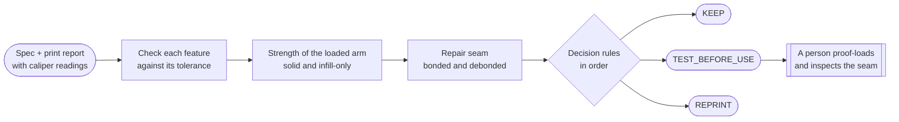

# fdm-agent-skills

*Can we still use this print?*

Our Project 2 loop pauses a 3D print when the camera sees a failure and corrects the remaining layers. This repo
holds an expert Agent Skill that decides what to do with the finished part: **KEEP**, **TEST_BEFORE_USE** or
**REPRINT**. It is written twice, once as a document only and once with a script, and both are run by the same
agent on the same task.

CMU 24-679 HW6



## The two versions

| | [`fdm-part-acceptance-md`](skills/fdm-part-acceptance-md/SKILL.md) | [`fdm-part-acceptance-scripts`](skills/fdm-part-acceptance-scripts/SKILL.md) |
|---|---|---|
| Files | `SKILL.md` only | `SKILL.md`, `scripts/check_part.py`, `references/` |
| Numbers | worked out by hand by the agent | computed by the script; the agent picks the inputs |
| Shell | denied | allowed |

Both share the same scope, inputs and decision rules. The script reuses my HW5 tools `check_deviated_part` and
`check_cantilever` unchanged (`scripts/fdm_core/`, from
[fdm-mcp-server](https://github.com/akshara-ns/fdm-mcp-server)).

## The task

Our team's bracket test part ([`case/bracket.yaml`](case/bracket.yaml), the real spec), paused after layer 17
and corrected. The print report ([`case/print_report.md`](case/print_report.md)) is a made-up scenario, not a
real print.

| Check | Value |
|---|---|
| Safety factor, solid section | 3.03 |
| Safety factor, top and bottom layers only (15 % infill) | 1.82 |
| Safety factor if the seam lets go | 1.41 (target 1.5) |
| Reprint | 48 min, $0.70 |
| **Decision** | **TEST_BEFORE_USE** |

## Run it

**In Colab:** open [`HW6_part_acceptance_skills.ipynb`](https://colab.research.google.com/github/akshara-ns/fdm-agent-skills/blob/main/HW6_part_acceptance_skills.ipynb),
add the secret `ANTHROPIC_API_KEY`, then **Runtime → Run all**. It installs OpenCode 2.3.0, runs each skill in a
fresh session with `claude-sonnet-5-5`, and checks both answers against a hand calculation and an MCP call to
`check_deviated_part`.

**The script alone** (Python 3.10+, standard library only):

```bash
python3 skills/fdm-part-acceptance-scripts/scripts/check_part.py --selftest
python3 skills/fdm-part-acceptance-scripts/scripts/check_part.py check/reference_case.json
```

## Repo

| Path | What it holds |
|---|---|
| `skills/` | the two skills |
| `case/` | the task: bracket spec and print report |
| `check/` | independent checks: my own case encoding and the MCP call |
| `artifact/` | Project 2 artifact: camera calibration for the printer's moving bed ([README](artifact/README.md)) |

## How I used AI tools

- **Claude Code** helped write the skills, the script, the scenario and the notebook. I chose the task and the
  decision rules, and checked every number against a hand calculation.
- **In the demo**, Claude Sonnet 5.5 runs inside OpenCode and its answers are shown unedited.

MIT licence, except `artifact/`, which is copied from our team's private repo for grading.
