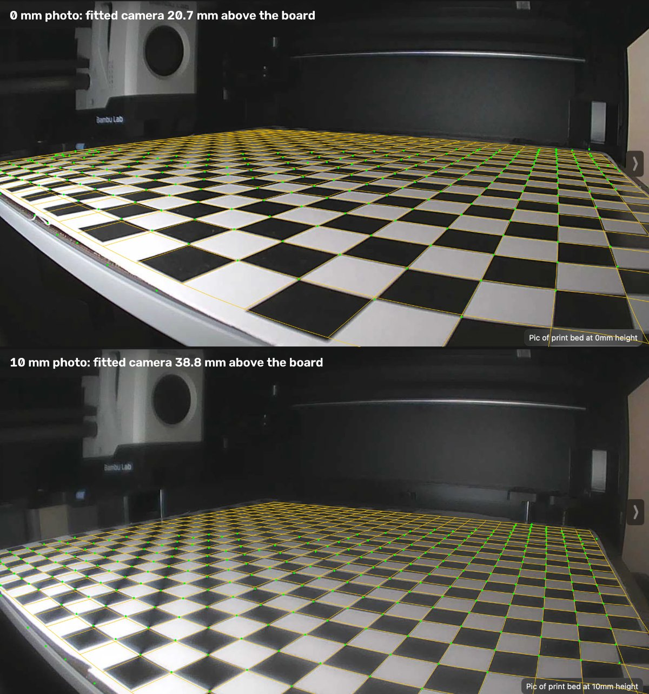

# Camera calibration for a moving bed

*Project 2 artifact for HW6*

The Bambu Lab P1S camera is fixed, but the bed drops one layer at a time. Our loop compares every frame with the
sliced layer, so it has to know where the bed was when each frame was grabbed. On this camera, 1 mm of height
error moves points about 8 mm on the bed.

| | |
|---|---|
| **Dates** | 11 Nov 2026 first version · 15 Nov 2026 merged into the team branch (PR #7) · 15 Nov 2026 capture fixes (PR #9, open) |
| **Status** | In progress. Code and 24 tests pass; not yet calibrated from raw printer frames |
| **My part** | `calibrate-board` and the moving-bed correction: [`code/calib_board.py`](code/calib_board.py), both test files, [`docs/calibration-board.md`](docs/calibration-board.md) |
| **Team's part** | Srivathsan B. wrote the checkerboard-free method ([`docs/calibration-without-checkerboard.md`](docs/calibration-without-checkerboard.md)); Sohum G. reviewed and merged |

## Evidence

- **Tests:** 24 of 24 pass ([`tests/test_results.txt`](tests/test_results.txt)), e.g. a wrong bed height is caught and a
  single flat photo is refused.
- **First real photos:** the board at bed "0 mm" and "10 mm" gave camera heights of 20.7 mm and 38.8 mm. The first
  fits the measured 22.8 mm with a 2 mm board; the second implies the bed moved 18 mm, not 10.

Copied unchanged from our private team repo (commit `0d4df0d`). The tests import other team modules, so they run
there: `python -m pytest tests/test_calib_board.py tests/test_moving_bed.py`.
